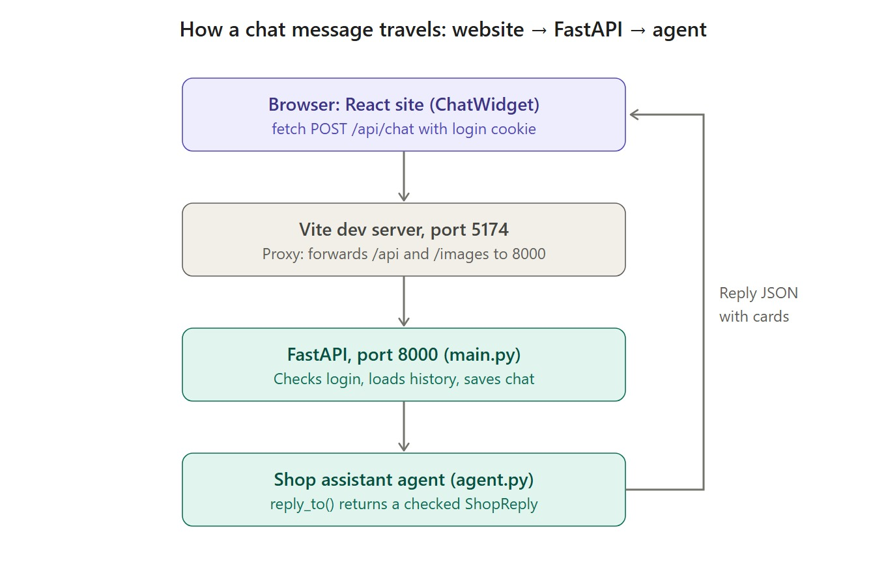
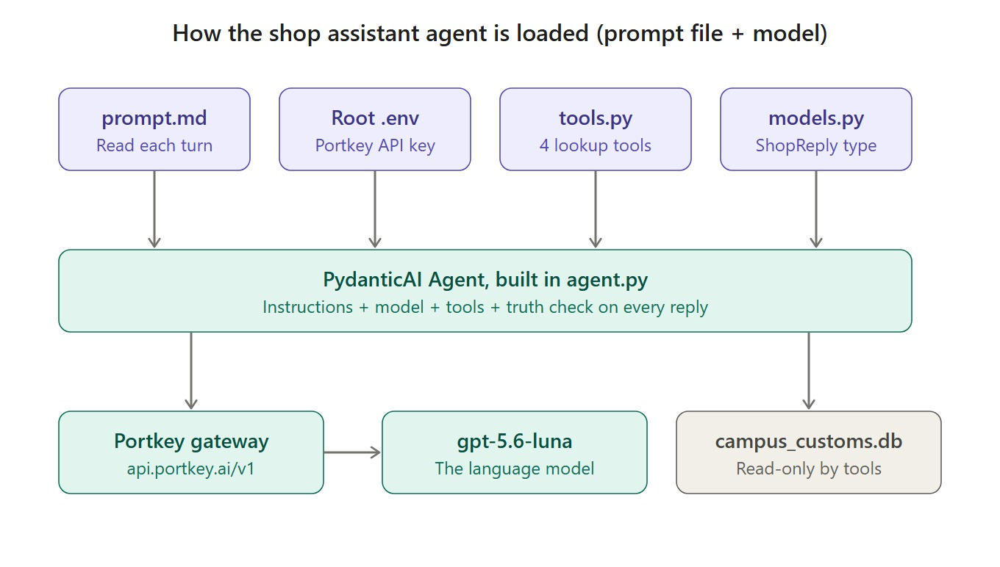

# Notes: how the front end talks to FastAPI, and how the agent is loaded

## 1. How the front end talks to FastAPI

When a shopper types in the chat:

1. **The browser sends the message.** `frontend/src/components/ChatWidget.tsx` calls a helper in `frontend/src/api.ts` that sends `{"message": "..."}` with `POST /api/chat`. The browser automatically includes the login cookie (`cc_session`), which proves who is asking.
2. **Vite forwards it.** The browser only knows the site's address, `localhost:5174`. Vite, the development server that serves the React pages, has a forwarding rule in `frontend/vite.config.ts`: anything starting with `/api` or `/images` goes to FastAPI on port **8000**. So the front end never needs to know FastAPI's address. (If another app already has 8000, start both with the same `API_PORT`, e.g. 8001.)
3. **FastAPI checks and prepares** (`backend/main.py`, the `/api/chat` route).
   - **Who's asking:** it reads the cookie to find the shopper. It refuses anyone not logged in (401) or whose old password must be changed (403).
   - **Limits:** at most 20 messages per 10 minutes (429).
   - **Context:** it loads the shopper's last 20 chat messages.
4. **The agent answers.** FastAPI calls `agent.reply_to(...)` with the message, the shopper's first name and that history.
5. **The reply goes back.** FastAPI saves both messages in the `chat_messages` table, then returns JSON: the reply text plus **product cards** with live prices. The chat widget shows the text as a bubble and the cards underneath.

The other pages work the same way: they call routes such as `/api/products` and `/api/auth/login` through the same Vite forwarding rule.

## 2. How the agent is loaded (prompt file + model)

### Once, when the server starts

`backend/main.py` imports `backend/agent.py`, which:

- **Gets the key:** reads `PORTKEY_API_KEY` from the **root `.env`** file.
- **Creates the client:** an OpenAI-compatible client pointed at the **Portkey** gateway (`https://api.portkey.ai/v1`). Portkey forwards requests to the AI provider.
- **Wraps the model:** that client becomes the model **`gpt-5.6-luna`** (`OpenAIChatModel`).
- **Builds the agent:** a PydanticAI `Agent` from:
  - the model;
  - the **4 tools** in `backend/tools.py`: `search_products`, `get_product_details`, `check_stock`, `list_categories`;
  - the **`ShopReply`** reply type in `backend/models.py` (reply text plus up to 6 product ids);
  - a **truth check** that inspects every reply.

### Every time a message arrives

- **The prompt file is read fresh.** `backend/prompts/prompt.md` is read again, with today's date and the shopper's first name added. Edits to the prompt take effect without restarting the server.
- **The model looks things up.** Through Portkey, `gpt-5.6-luna` decides which tools to call. The tools read `campus_customs.db` **read-only**: catalogue and stock only, never accounts.
- **The reply is checked.** It must match the `ShopReply` shape and pass the truth check: every price and product card must have come from a tool during this reply. A failing reply is sent back to the model to fix. If it still can't produce a checkable answer, the shopper gets an honest "I couldn't double-check that."

## Quick reference

| Piece | File | Address / setting |
|---|---|---|
| Website | `frontend/` (React + Vite + TypeScript) | http://localhost:5174 |
| Forwarding rule | `frontend/vite.config.ts` | `/api`, `/images` → port 8000 (or `API_PORT`) |
| API | `backend/main.py` | http://127.0.0.1:8000. From `backend/`: `uvicorn main:app --reload --port 8000` |
| Chat route | `backend/main.py` | `POST /api/chat`, `GET /api/chat/history` |
| Agent | `backend/agent.py` | PydanticAI `Agent` |
| System prompt | `backend/prompts/prompt.md` | Re-read on every message |
| Model | `backend/agent.py` | `gpt-5.6-luna` via Portkey; key in the root `.env` |
| Tools | `backend/tools.py` | 4 read-only catalogue tools |
| Reply and card types | `backend/models.py` | `ShopReply`, `ChatMessageOut`, `ProductSummary` |
